# bicycle: individual renders (bicycle_4g_v32_w35)

Lossless full-resolution PNGs (8-bit, not resized). Error map: black = identical, white = pixel error >= 0.25 of full brightness. `zoom4x` = the yellow box of `../renders.jpg` (the window, 1/4 of the image's width and height, where the GA genome's error is highest, the same for every column of a view) cut out at native pixels; the overview shows it {ZOOM}x larger. PSNR is against the unpruned render of the same view.

## worst test view (test image `_DSC8695`, 1237x822)

| | render | error map | zoom |
|---|---|---|---|
| **unpruned (reference)** `worst_view__DSC8695__unpruned.png` |  |  |  |
| **GA best: 60.5% of Gaussians kept, 34.3 dB PSNR vs unpruned** `worst_view__DSC8695__ga_best__60.5pct_kept__34.3dB.png` | <a href="worst_view__DSC8695__ga_best__60.5pct_kept__34.3dB.png">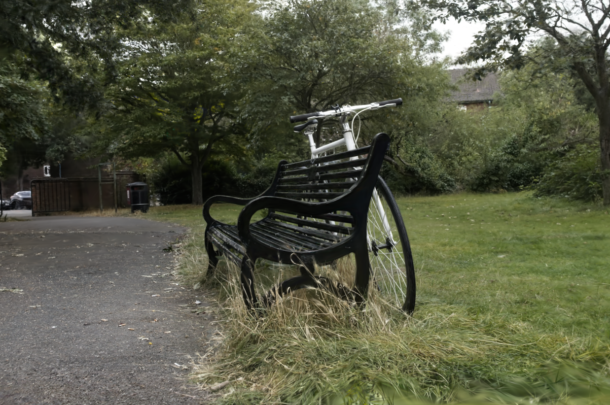</a> | <a href="worst_view__DSC8695__ga_best__60.5pct_kept__34.3dB__error.png">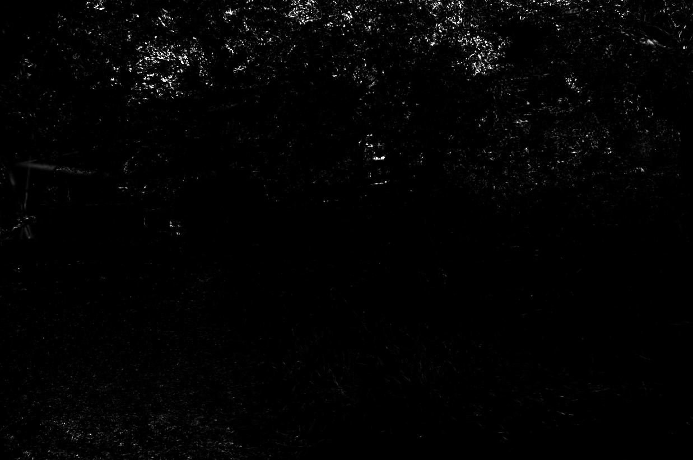</a> | <a href="worst_view__DSC8695__ga_best__60.5pct_kept__34.3dB__zoom4x.png">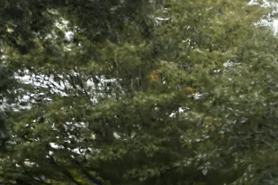</a> |
| **importance sweep: 60.3% of Gaussians kept, 34.3 dB PSNR vs unpruned** `worst_view__DSC8695__importance_sweep__60.3pct_kept__34.3dB.png` |  | <a href="worst_view__DSC8695__importance_sweep__60.3pct_kept__34.3dB__error.png">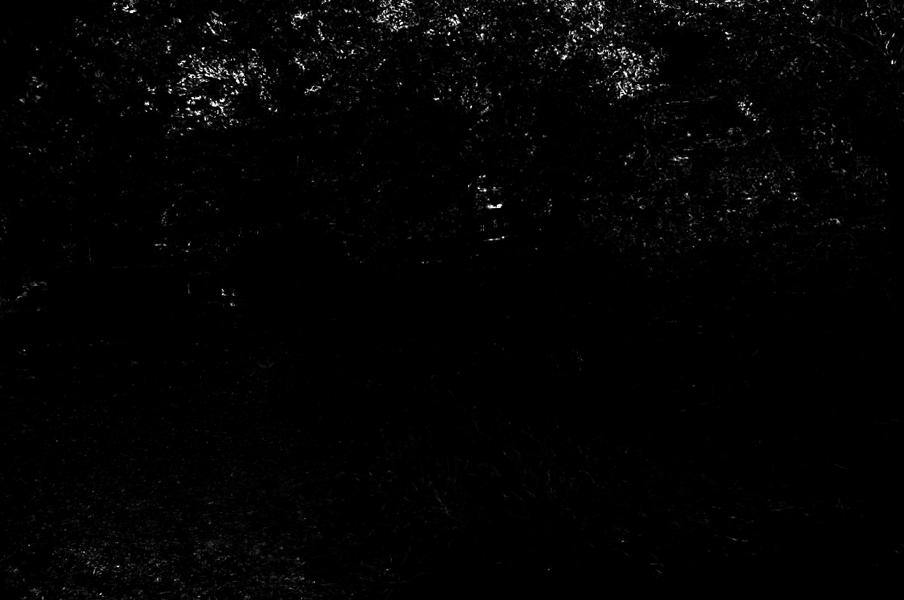</a> | <a href="worst_view__DSC8695__importance_sweep__60.3pct_kept__34.3dB__zoom4x.png">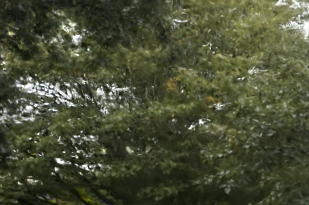</a> |
| **opacity sweep: 74.1% of Gaussians kept, 42.2 dB PSNR vs unpruned** `worst_view__DSC8695__opacity_sweep__74.1pct_kept__42.2dB.png` | <a href="worst_view__DSC8695__opacity_sweep__74.1pct_kept__42.2dB.png">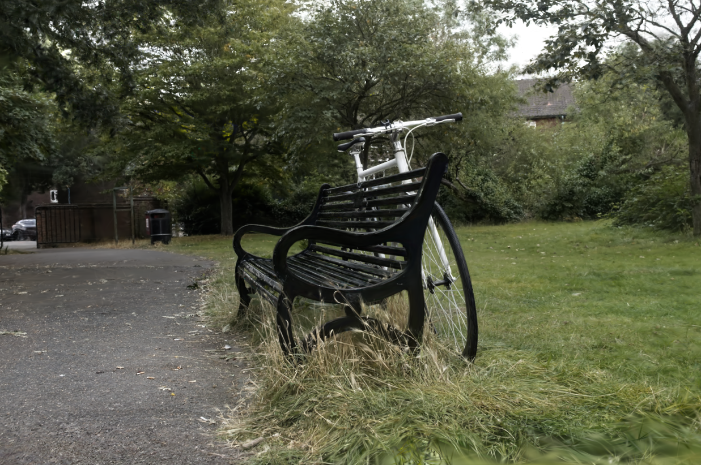</a> | <a href="worst_view__DSC8695__opacity_sweep__74.1pct_kept__42.2dB__error.png">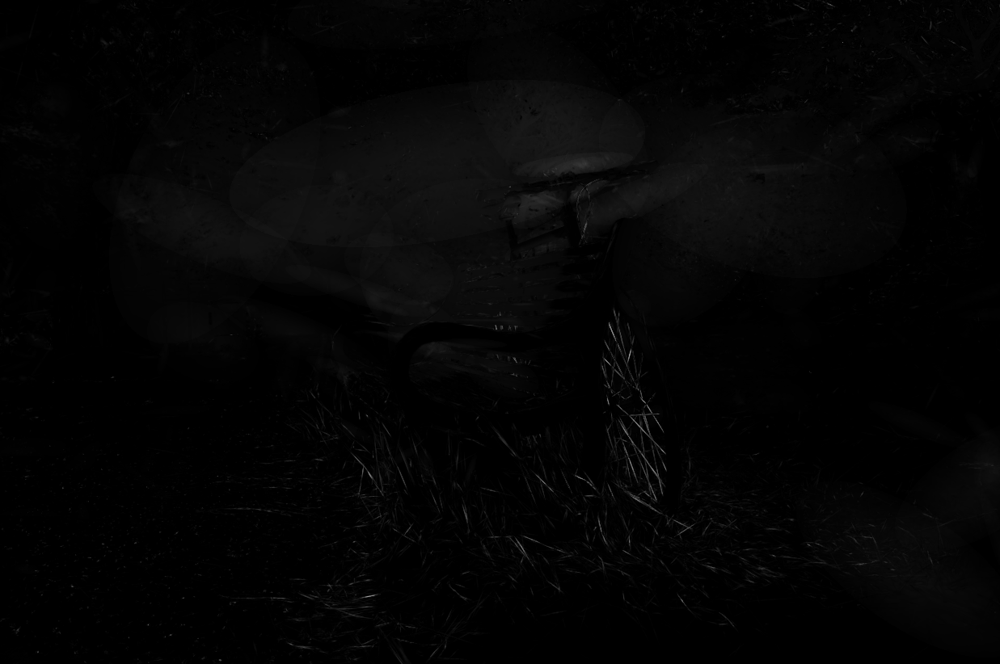</a> | <a href="worst_view__DSC8695__opacity_sweep__74.1pct_kept__42.2dB__zoom4x.png">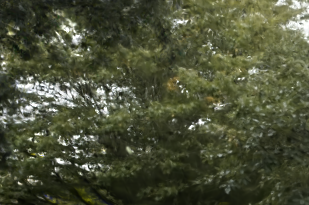</a> |

## median test view (test image `_DSC8832`, 1237x822)

| | render | error map | zoom |
|---|---|---|---|
| **unpruned (reference)** `median_view__DSC8832__unpruned.png` |  |  | <a href="median_view__DSC8832__unpruned__zoom4x.png">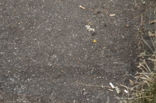</a> |
| **GA best: 60.5% of Gaussians kept, 47.9 dB PSNR vs unpruned** `median_view__DSC8832__ga_best__60.5pct_kept__47.9dB.png` |  | <a href="median_view__DSC8832__ga_best__60.5pct_kept__47.9dB__error.png">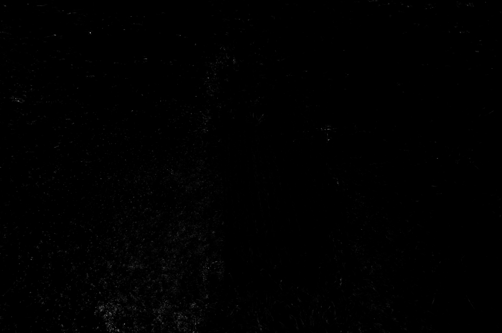</a> | <a href="median_view__DSC8832__ga_best__60.5pct_kept__47.9dB__zoom4x.png">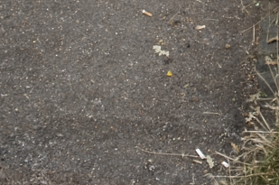</a> |
| **importance sweep: 60.3% of Gaussians kept, 47.8 dB PSNR vs unpruned** `median_view__DSC8832__importance_sweep__60.3pct_kept__47.8dB.png` | <a href="median_view__DSC8832__importance_sweep__60.3pct_kept__47.8dB.png">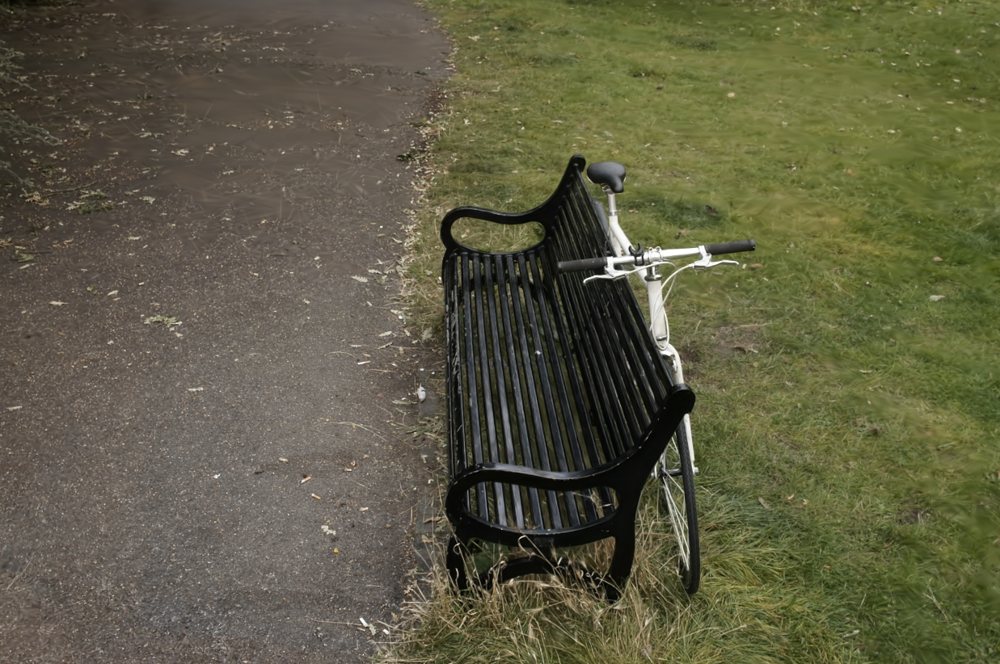</a> | <a href="median_view__DSC8832__importance_sweep__60.3pct_kept__47.8dB__error.png">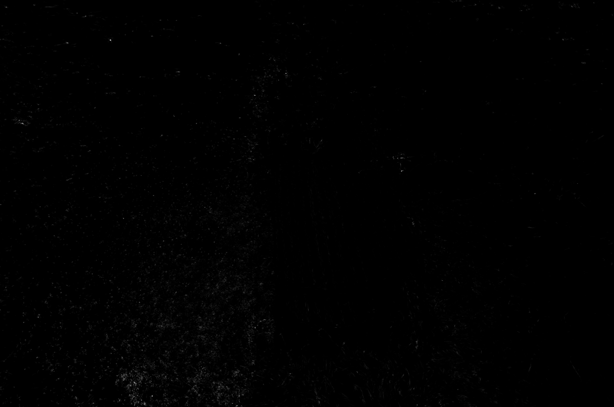</a> | <a href="median_view__DSC8832__importance_sweep__60.3pct_kept__47.8dB__zoom4x.png">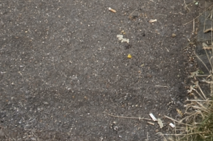</a> |
| **opacity sweep: 74.1% of Gaussians kept, 45.7 dB PSNR vs unpruned** `median_view__DSC8832__opacity_sweep__74.1pct_kept__45.7dB.png` |  | <a href="median_view__DSC8832__opacity_sweep__74.1pct_kept__45.7dB__error.png">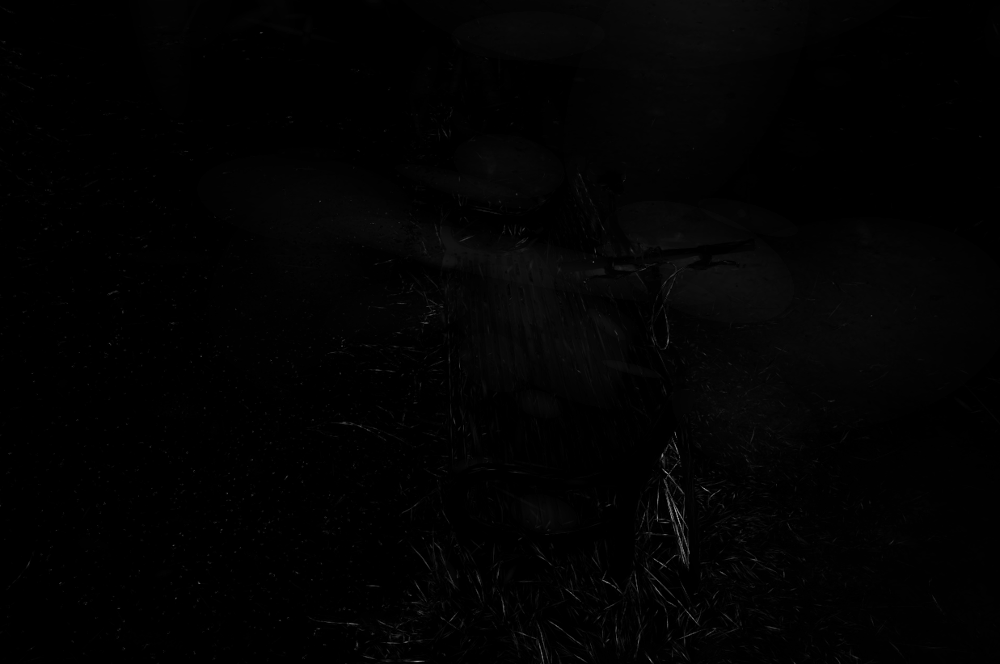</a> | <a href="median_view__DSC8832__opacity_sweep__74.1pct_kept__45.7dB__zoom4x.png">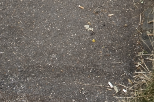</a> |
