# bicycle: individual renders (bicycle_4g_v32_w35_imax_res1_sres1)

Lossless full-resolution PNGs (8-bit, not resized). Error map: black = identical, white = pixel error >= 0.25 of full brightness. `zoom4x` = the yellow box of `../renders.jpg` (the window, 1/4 of the image's width and height, where the GA genome's error is highest, the same for every column of a view) cut out at native pixels; the overview shows it {ZOOM}x larger. PSNR is against the unpruned render of the same view.

## worst test view (test image `_DSC8816`, 1237x822)

| | render | error map | zoom |
|---|---|---|---|
| **unpruned (reference)** `worst_view__DSC8816__unpruned.jpg` | <a href="worst_view__DSC8816__unpruned.jpg">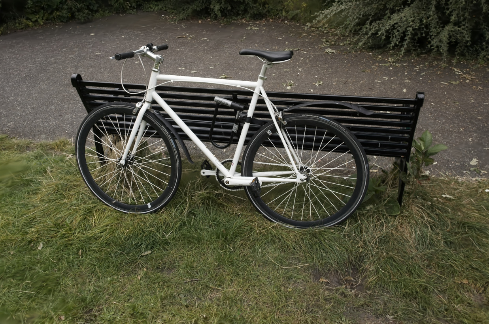</a> |  | <a href="worst_view__DSC8816__unpruned__zoom4x.jpg">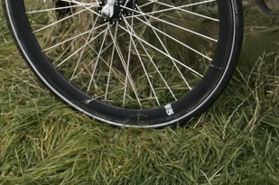</a> |
| **GA best: 55.8% of Gaussians kept, 36.8 dB PSNR vs unpruned** `worst_view__DSC8816__ga_best__55.8pct_kept__36.8dB.jpg` |  |  | <a href="worst_view__DSC8816__ga_best__55.8pct_kept__36.8dB__zoom4x.jpg">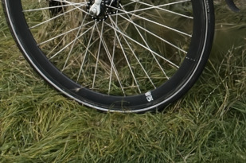</a> |
| **importance sweep: 55.6% of Gaussians kept, 36.6 dB PSNR vs unpruned** `worst_view__DSC8816__importance_sweep__55.6pct_kept__36.6dB.jpg` |  | <a href="worst_view__DSC8816__importance_sweep__55.6pct_kept__36.6dB__error.jpg">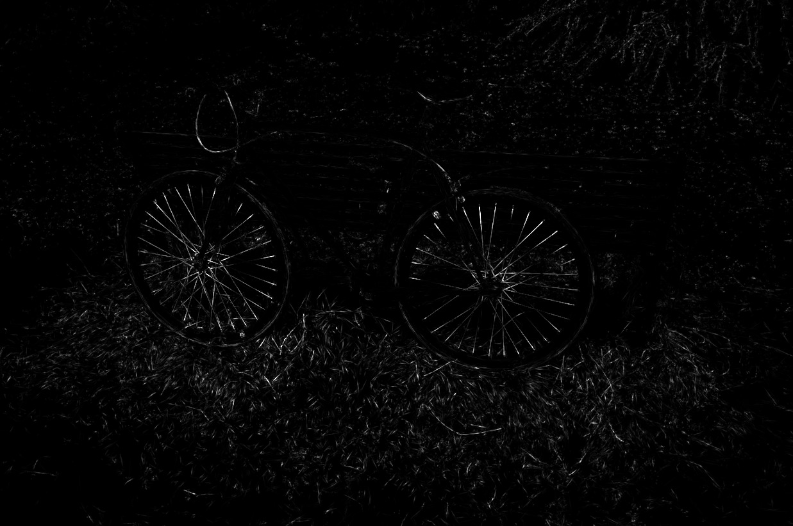</a> | <a href="worst_view__DSC8816__importance_sweep__55.6pct_kept__36.6dB__zoom4x.jpg">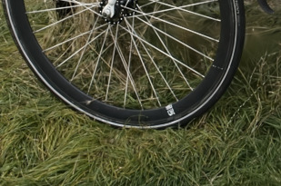</a> |
| **opacity sweep: 71.4% of Gaussians kept, 36.4 dB PSNR vs unpruned** `worst_view__DSC8816__opacity_sweep__71.4pct_kept__36.4dB.jpg` |  | <a href="worst_view__DSC8816__opacity_sweep__71.4pct_kept__36.4dB__error.jpg">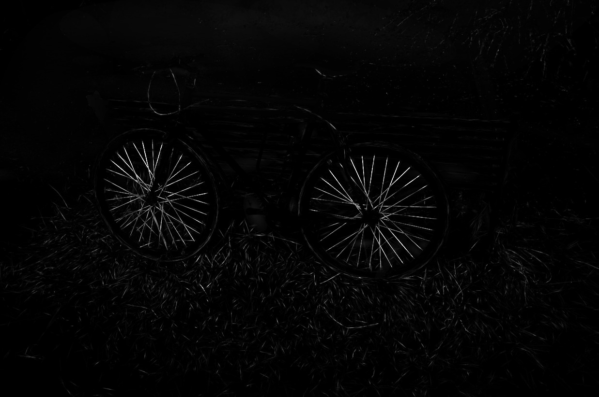</a> | <a href="worst_view__DSC8816__opacity_sweep__71.4pct_kept__36.4dB__zoom4x.jpg">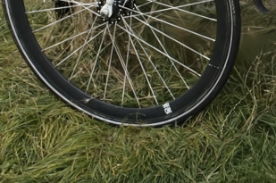</a> |

## median test view (test image `_DSC8703`, 1237x822)

| | render | error map | zoom |
|---|---|---|---|
| **unpruned (reference)** `median_view__DSC8703__unpruned.jpg` | <a href="median_view__DSC8703__unpruned.jpg">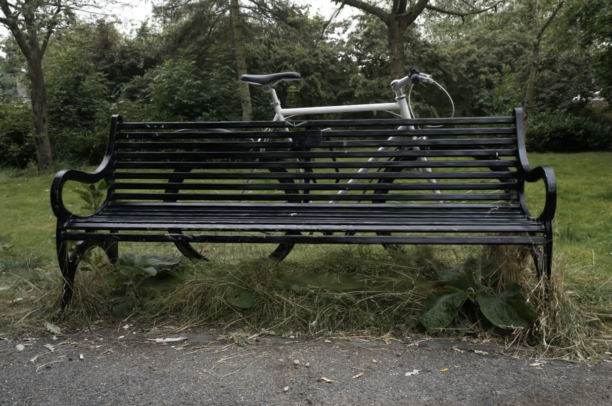</a> |  | <a href="median_view__DSC8703__unpruned__zoom4x.jpg">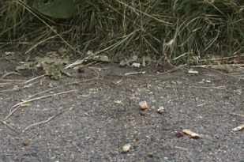</a> |
| **GA best: 55.8% of Gaussians kept, 40.2 dB PSNR vs unpruned** `median_view__DSC8703__ga_best__55.8pct_kept__40.2dB.jpg` | <a href="median_view__DSC8703__ga_best__55.8pct_kept__40.2dB.jpg">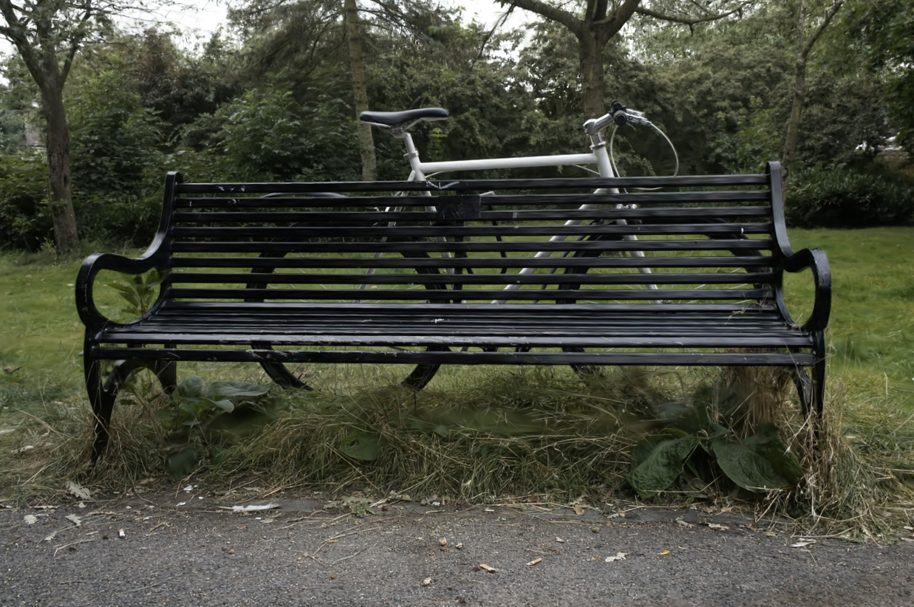</a> | <a href="median_view__DSC8703__ga_best__55.8pct_kept__40.2dB__error.jpg">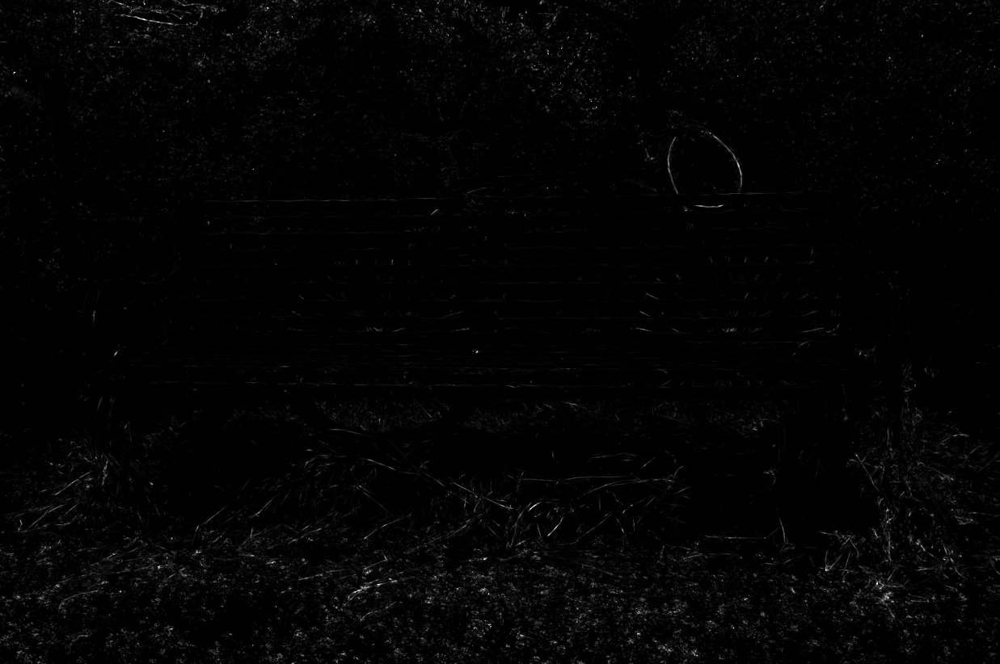</a> | <a href="median_view__DSC8703__ga_best__55.8pct_kept__40.2dB__zoom4x.jpg">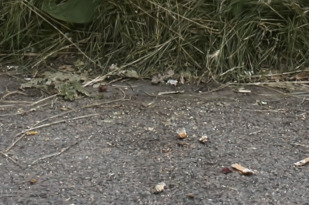</a> |
| **importance sweep: 55.6% of Gaussians kept, 40.1 dB PSNR vs unpruned** `median_view__DSC8703__importance_sweep__55.6pct_kept__40.1dB.jpg` | <a href="median_view__DSC8703__importance_sweep__55.6pct_kept__40.1dB.jpg">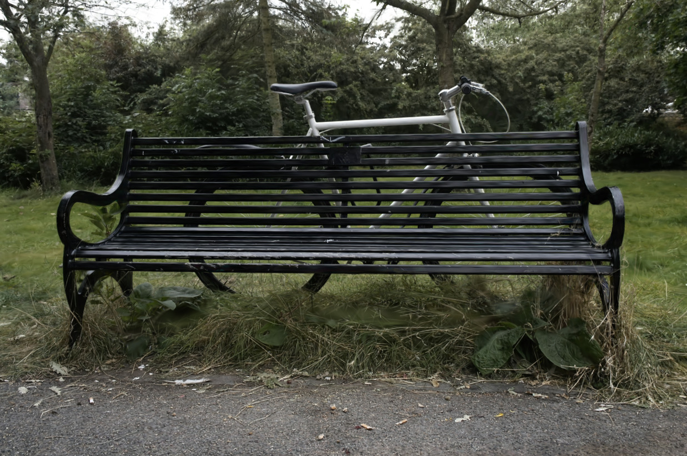</a> |  | <a href="median_view__DSC8703__importance_sweep__55.6pct_kept__40.1dB__zoom4x.jpg">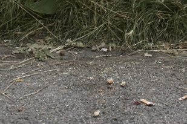</a> |
| **opacity sweep: 71.4% of Gaussians kept, 42.1 dB PSNR vs unpruned** `median_view__DSC8703__opacity_sweep__71.4pct_kept__42.1dB.jpg` | <a href="median_view__DSC8703__opacity_sweep__71.4pct_kept__42.1dB.jpg">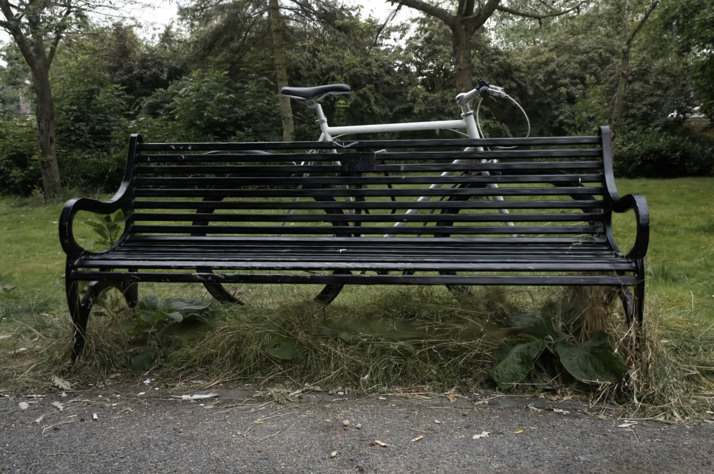</a> | <a href="median_view__DSC8703__opacity_sweep__71.4pct_kept__42.1dB__error.jpg">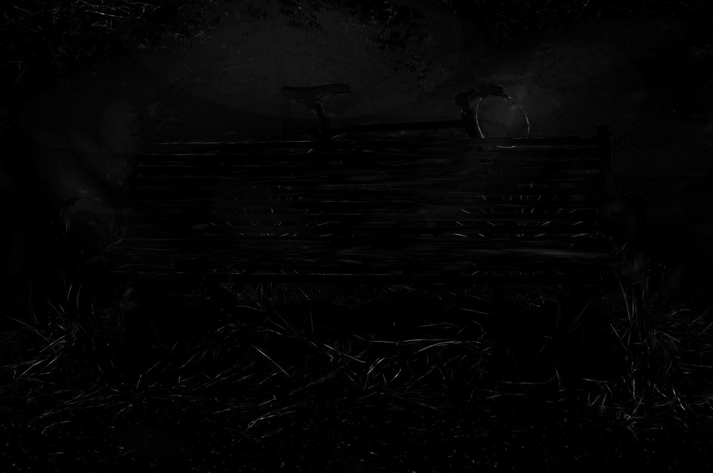</a> | <a href="median_view__DSC8703__opacity_sweep__71.4pct_kept__42.1dB__zoom4x.jpg">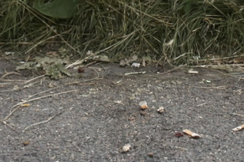</a> |
