# bonsai: individual renders (bonsai_4g_v32_w35)

Lossless full-resolution PNGs (8-bit, not resized). Error map: black = identical, white = pixel error >= 0.25 of full brightness. `zoom4x` = the yellow box of `../renders.jpg` (the window, 1/4 of the image's width and height, where the GA genome's error is highest, the same for every column of a view) cut out at native pixels; the overview shows it {ZOOM}x larger. PSNR is against the unpruned render of the same view.

## worst test view (test image `DSCF5661`, 1559x1039)

| | render | error map | zoom |
|---|---|---|---|
| **unpruned (reference)** `worst_view_DSCF5661__unpruned.png` | <a href="worst_view_DSCF5661__unpruned.png">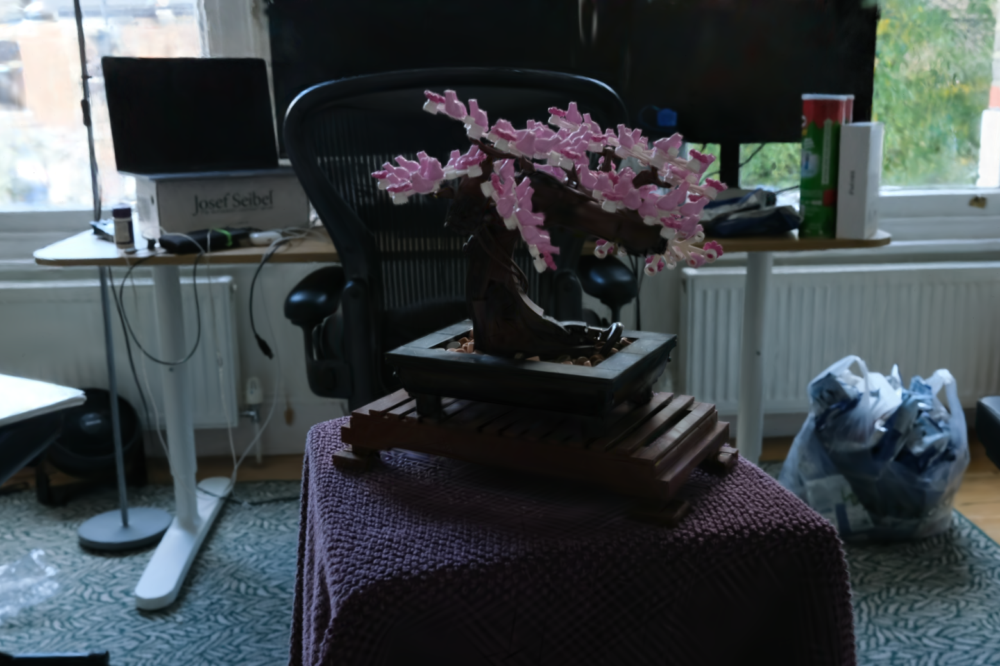</a> |  |  |
| **GA best: 52.2% of Gaussians kept, 32.0 dB PSNR vs unpruned** `worst_view_DSCF5661__ga_best__52.2pct_kept__32.0dB.png` | <a href="worst_view_DSCF5661__ga_best__52.2pct_kept__32.0dB.png">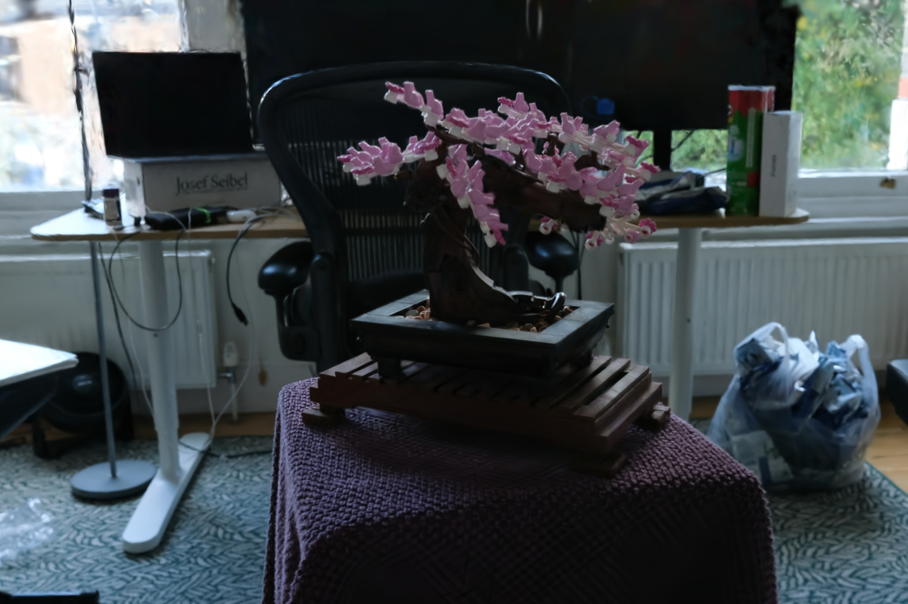</a> |  |  |
| **importance sweep: 50.8% of Gaussians kept, 31.0 dB PSNR vs unpruned** `worst_view_DSCF5661__importance_sweep__50.8pct_kept__31.0dB.png` | <a href="worst_view_DSCF5661__importance_sweep__50.8pct_kept__31.0dB.png">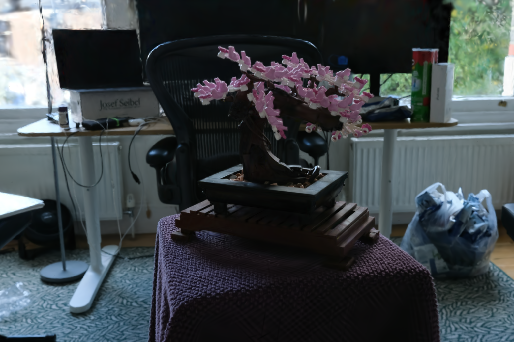</a> | <a href="worst_view_DSCF5661__importance_sweep__50.8pct_kept__31.0dB__error.png">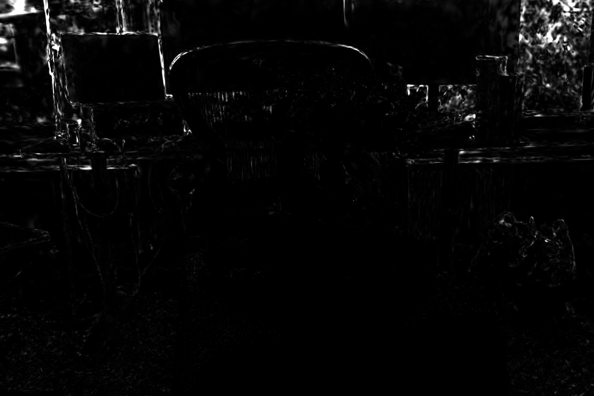</a> |  |
| **opacity sweep: 73.9% of Gaussians kept, 41.0 dB PSNR vs unpruned** `worst_view_DSCF5661__opacity_sweep__73.9pct_kept__41.0dB.png` | <a href="worst_view_DSCF5661__opacity_sweep__73.9pct_kept__41.0dB.png">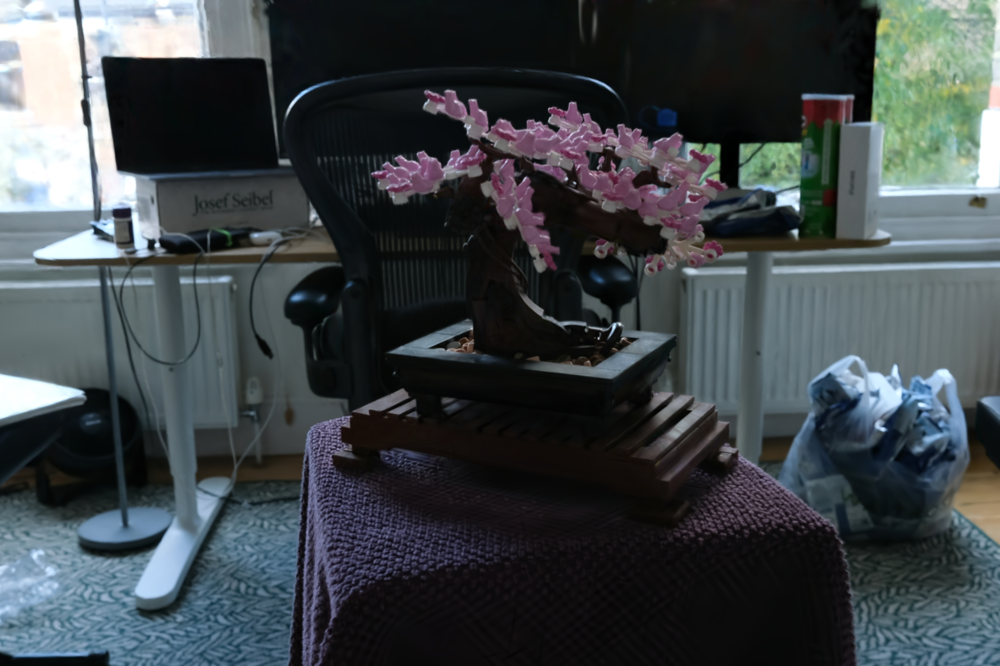</a> |  |  |

## median test view (test image `DSCF5677`, 1559x1039)

| | render | error map | zoom |
|---|---|---|---|
| **unpruned (reference)** `median_view_DSCF5677__unpruned.png` | <a href="median_view_DSCF5677__unpruned.png">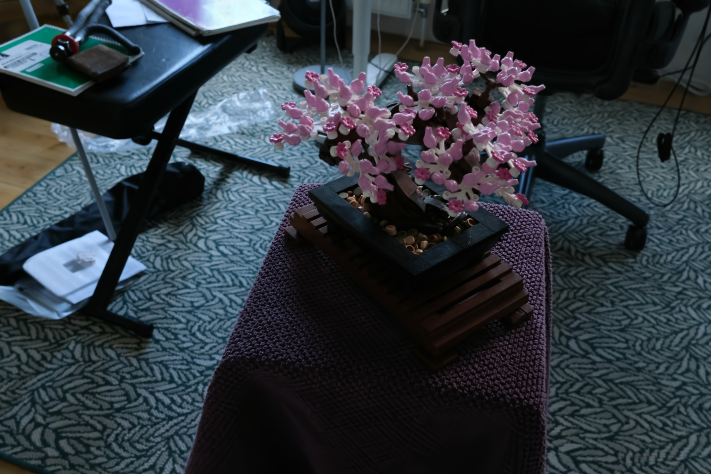</a> |  |  |
| **GA best: 52.2% of Gaussians kept, 45.5 dB PSNR vs unpruned** `median_view_DSCF5677__ga_best__52.2pct_kept__45.5dB.png` | <a href="median_view_DSCF5677__ga_best__52.2pct_kept__45.5dB.png">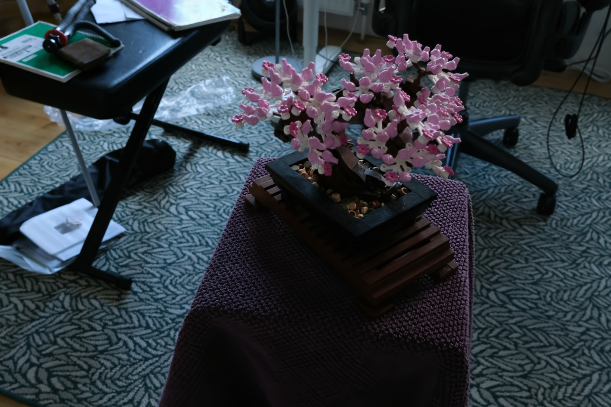</a> | <a href="median_view_DSCF5677__ga_best__52.2pct_kept__45.5dB__error.png">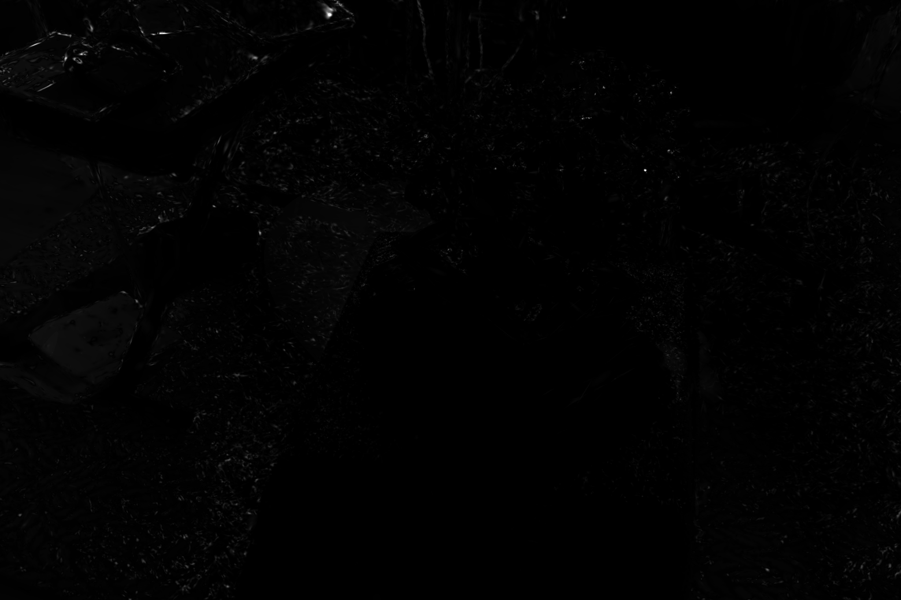</a> | <a href="median_view_DSCF5677__ga_best__52.2pct_kept__45.5dB__zoom4x.png">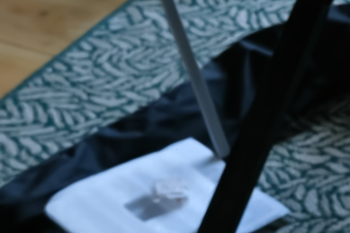</a> |
| **importance sweep: 50.8% of Gaussians kept, 45.0 dB PSNR vs unpruned** `median_view_DSCF5677__importance_sweep__50.8pct_kept__45.0dB.png` |  | <a href="median_view_DSCF5677__importance_sweep__50.8pct_kept__45.0dB__error.png">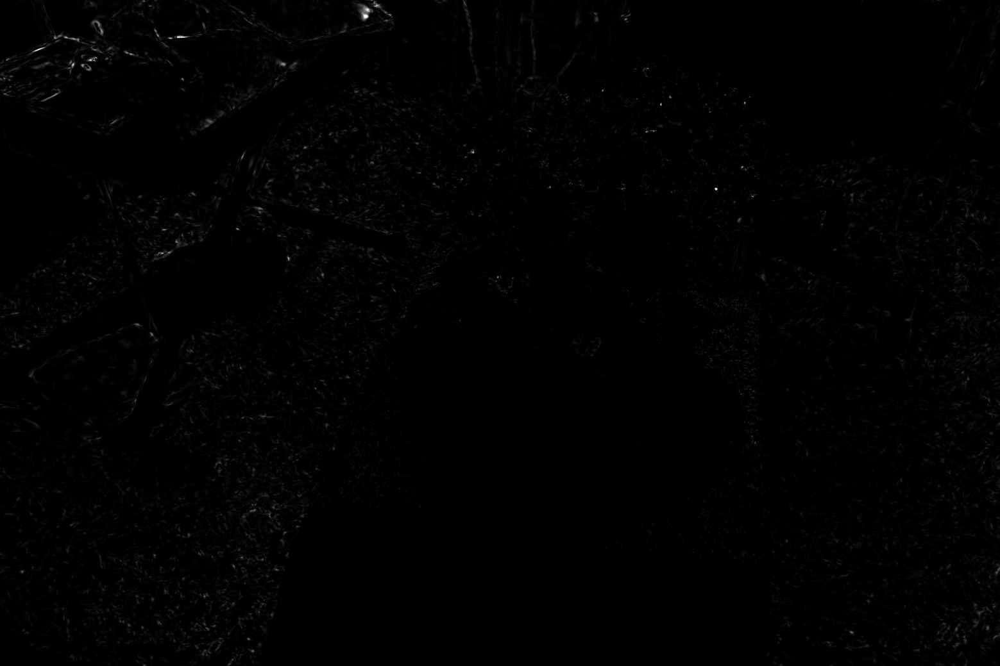</a> | <a href="median_view_DSCF5677__importance_sweep__50.8pct_kept__45.0dB__zoom4x.png">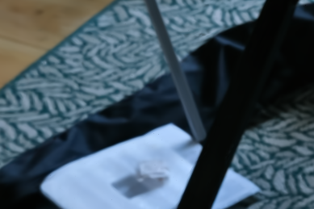</a> |
| **opacity sweep: 73.9% of Gaussians kept, 42.7 dB PSNR vs unpruned** `median_view_DSCF5677__opacity_sweep__73.9pct_kept__42.7dB.png` |  | <a href="median_view_DSCF5677__opacity_sweep__73.9pct_kept__42.7dB__error.png">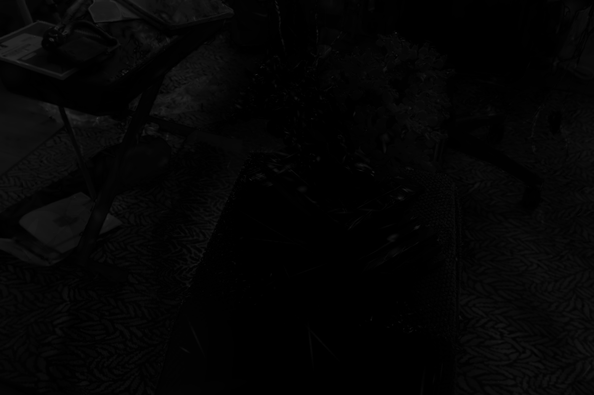</a> |  |
