# bonsai: individual renders (bonsai_4g_v32_w35_imax_res1_sres1)

Lossless full-resolution PNGs (8-bit, not resized). Error map: black = identical, white = pixel error >= 0.25 of full brightness. `zoom4x` = the yellow box of `../renders.jpg` (the window, 1/4 of the image's width and height, where the GA genome's error is highest, the same for every column of a view) cut out at native pixels; the overview shows it {ZOOM}x larger. PSNR is against the unpruned render of the same view.

## worst test view (test image `DSCF5837`, 1559x1039)

| | render | error map | zoom |
|---|---|---|---|
| **unpruned (reference)** `worst_view_DSCF5837__unpruned.jpg` | <a href="worst_view_DSCF5837__unpruned.jpg">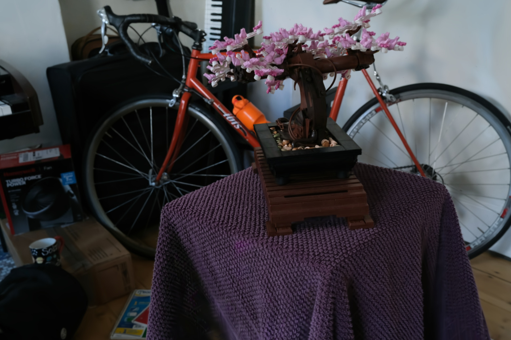</a> |  | <a href="worst_view_DSCF5837__unpruned__zoom4x.jpg">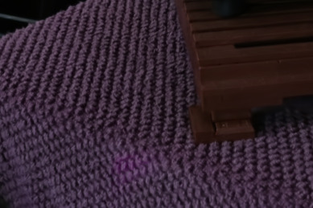</a> |
| **GA best: 52.1% of Gaussians kept, 38.1 dB PSNR vs unpruned** `worst_view_DSCF5837__ga_best__52.1pct_kept__38.1dB.jpg` |  | <a href="worst_view_DSCF5837__ga_best__52.1pct_kept__38.1dB__error.jpg">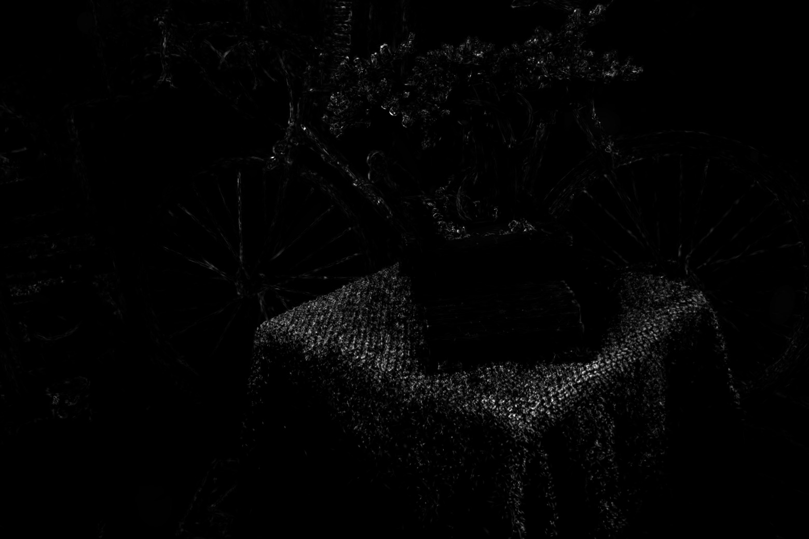</a> | <a href="worst_view_DSCF5837__ga_best__52.1pct_kept__38.1dB__zoom4x.jpg">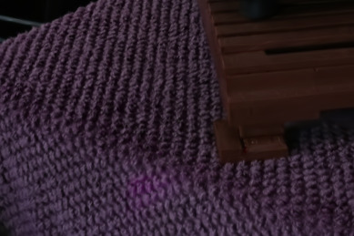</a> |
| **importance sweep: 52.0% of Gaussians kept, 38.1 dB PSNR vs unpruned** `worst_view_DSCF5837__importance_sweep__52.0pct_kept__38.1dB.jpg` | <a href="worst_view_DSCF5837__importance_sweep__52.0pct_kept__38.1dB.jpg">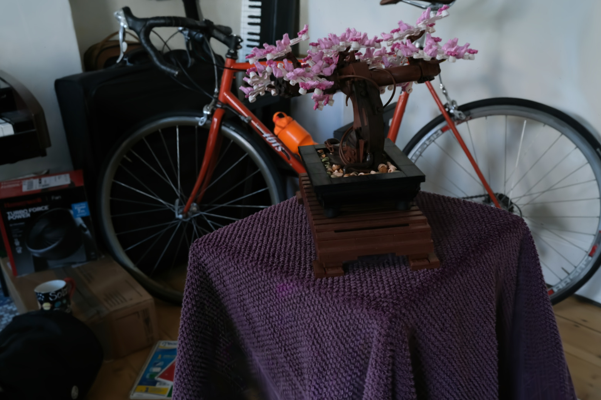</a> |  |  |
| **opacity sweep: 73.1% of Gaussians kept, 47.5 dB PSNR vs unpruned** `worst_view_DSCF5837__opacity_sweep__73.1pct_kept__47.5dB.jpg` | <a href="worst_view_DSCF5837__opacity_sweep__73.1pct_kept__47.5dB.jpg">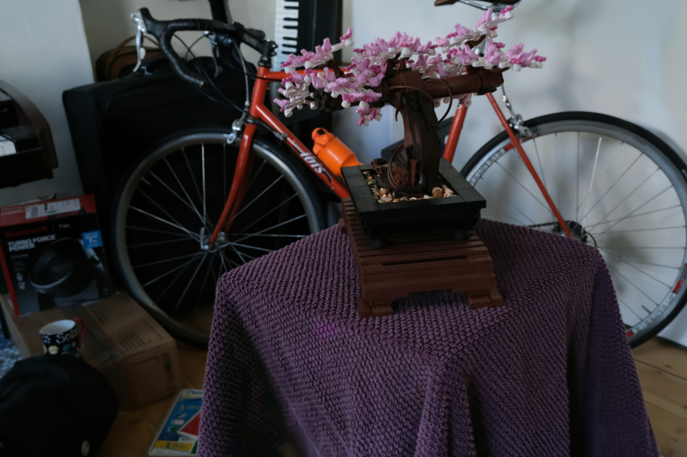</a> |  | <a href="worst_view_DSCF5837__opacity_sweep__73.1pct_kept__47.5dB__zoom4x.jpg">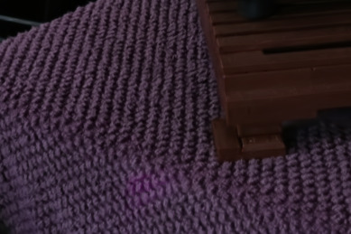</a> |

## median test view (test image `DSCF5669`, 1559x1039)

| | render | error map | zoom |
|---|---|---|---|
| **unpruned (reference)** `median_view_DSCF5669__unpruned.jpg` |  |  | <a href="median_view_DSCF5669__unpruned__zoom4x.jpg">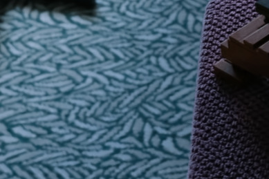</a> |
| **GA best: 52.1% of Gaussians kept, 39.7 dB PSNR vs unpruned** `median_view_DSCF5669__ga_best__52.1pct_kept__39.7dB.jpg` |  | <a href="median_view_DSCF5669__ga_best__52.1pct_kept__39.7dB__error.jpg">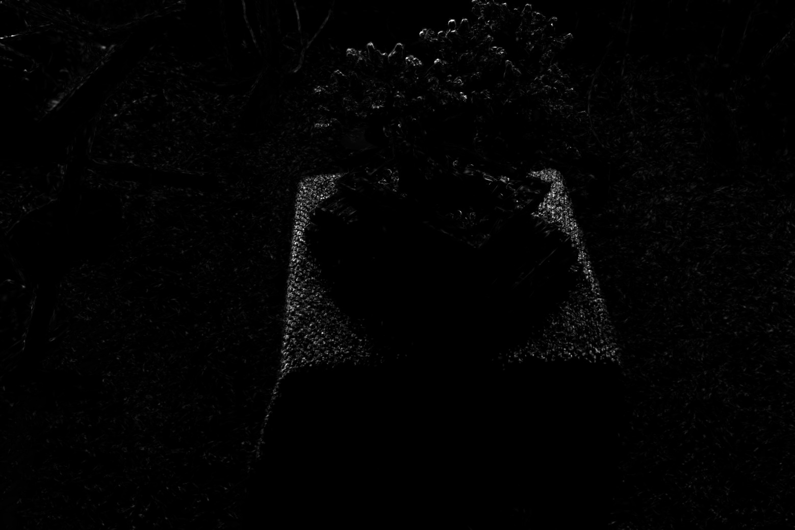</a> | <a href="median_view_DSCF5669__ga_best__52.1pct_kept__39.7dB__zoom4x.jpg">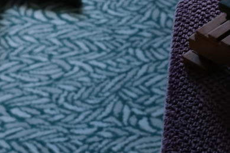</a> |
| **importance sweep: 52.0% of Gaussians kept, 39.7 dB PSNR vs unpruned** `median_view_DSCF5669__importance_sweep__52.0pct_kept__39.7dB.jpg` |  | <a href="median_view_DSCF5669__importance_sweep__52.0pct_kept__39.7dB__error.jpg">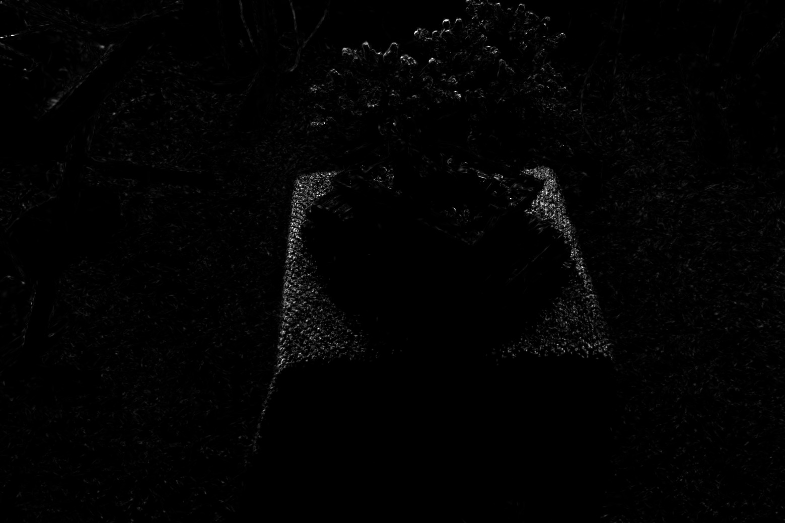</a> |  |
| **opacity sweep: 73.1% of Gaussians kept, 42.1 dB PSNR vs unpruned** `median_view_DSCF5669__opacity_sweep__73.1pct_kept__42.1dB.jpg` | <a href="median_view_DSCF5669__opacity_sweep__73.1pct_kept__42.1dB.jpg">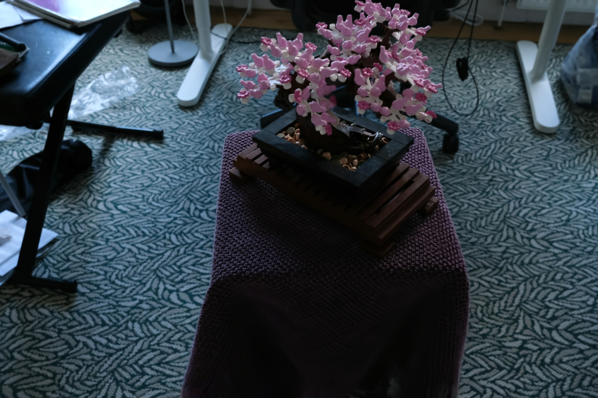</a> | <a href="median_view_DSCF5669__opacity_sweep__73.1pct_kept__42.1dB__error.jpg">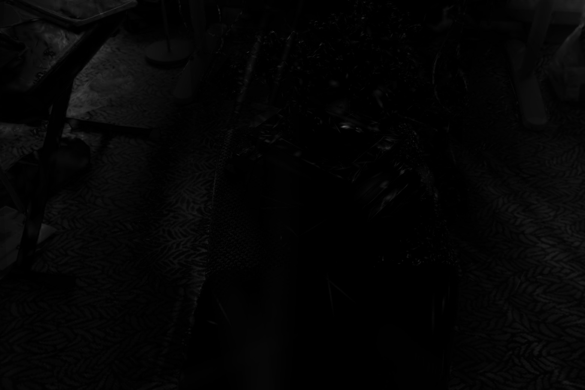</a> | <a href="median_view_DSCF5669__opacity_sweep__73.1pct_kept__42.1dB__zoom4x.jpg">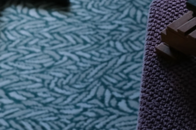</a> |
