# counter: individual renders (counter_4g_v32_w35)

Lossless full-resolution PNGs (8-bit, not resized). Error map: black = identical, white = pixel error >= 0.25 of full brightness. `zoom4x` = the yellow box of `../renders.jpg` (the window, 1/4 of the image's width and height, where the GA genome's error is highest, the same for every column of a view) cut out at native pixels; the overview shows it {ZOOM}x larger. PSNR is against the unpruned render of the same view.

## worst test view (test image `DSCF5961`, 1558x1038)

| | render | error map | zoom |
|---|---|---|---|
| **unpruned (reference)** `worst_view_DSCF5961__unpruned.png` | <a href="worst_view_DSCF5961__unpruned.png">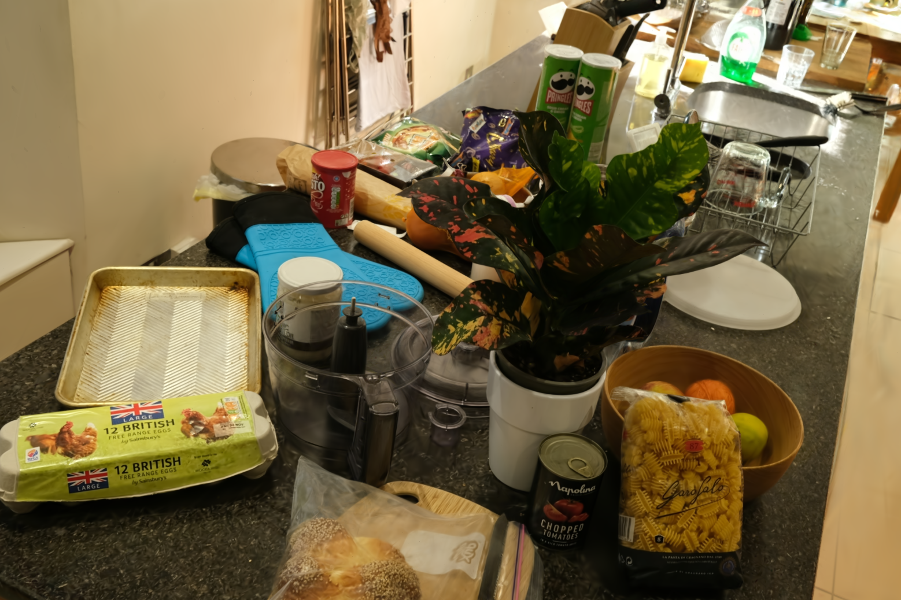</a> |  |  |
| **GA best: 52.4% of Gaussians kept, 35.5 dB PSNR vs unpruned** `worst_view_DSCF5961__ga_best__52.4pct_kept__35.5dB.png` | <a href="worst_view_DSCF5961__ga_best__52.4pct_kept__35.5dB.png">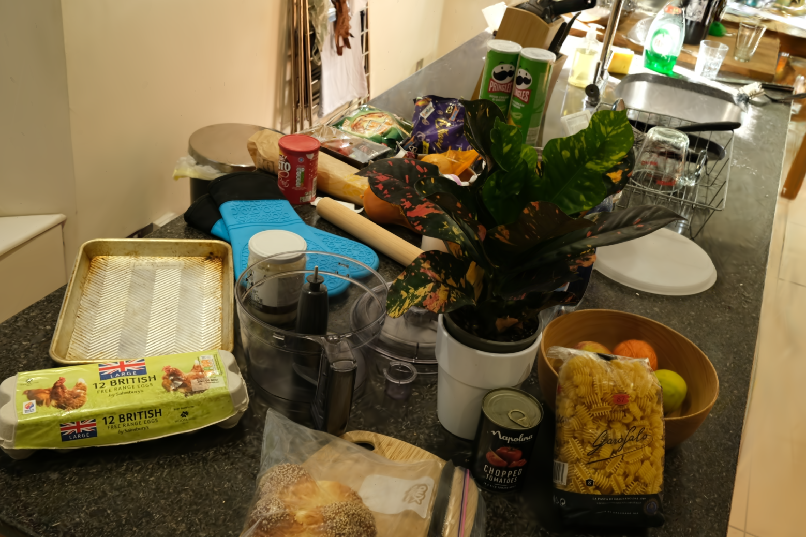</a> | <a href="worst_view_DSCF5961__ga_best__52.4pct_kept__35.5dB__error.png">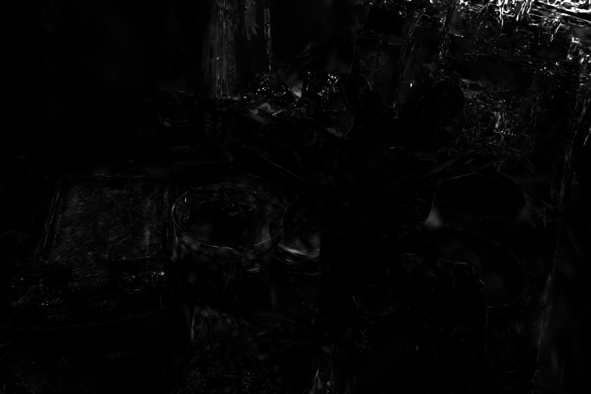</a> |  |
| **importance sweep: 55.6% of Gaussians kept, 35.1 dB PSNR vs unpruned** `worst_view_DSCF5961__importance_sweep__55.6pct_kept__35.1dB.png` | <a href="worst_view_DSCF5961__importance_sweep__55.6pct_kept__35.1dB.png">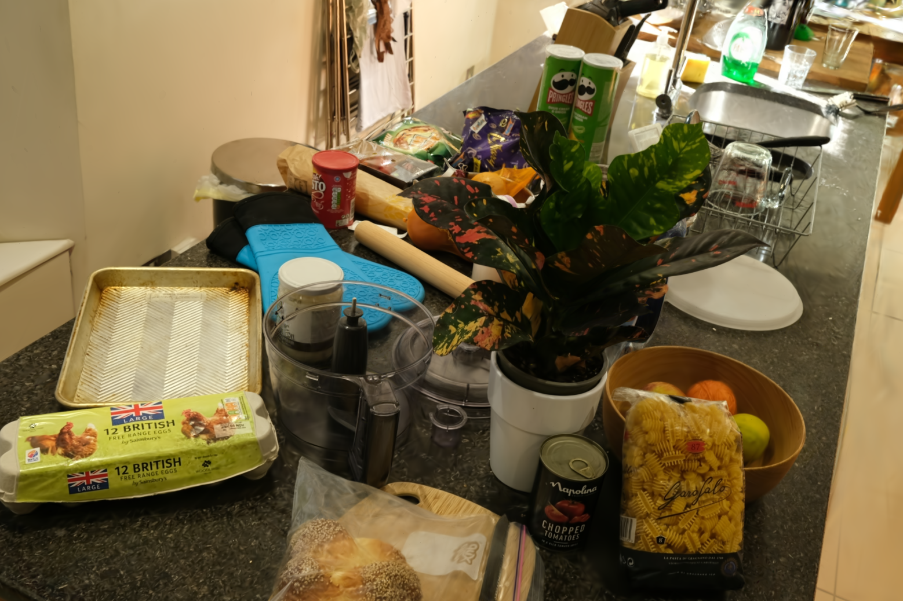</a> | <a href="worst_view_DSCF5961__importance_sweep__55.6pct_kept__35.1dB__error.png">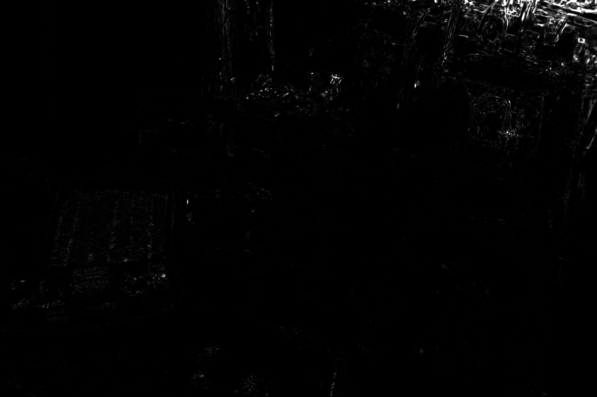</a> |  |
| **opacity sweep: 65.3% of Gaussians kept, 40.5 dB PSNR vs unpruned** `worst_view_DSCF5961__opacity_sweep__65.3pct_kept__40.5dB.png` |  | <a href="worst_view_DSCF5961__opacity_sweep__65.3pct_kept__40.5dB__error.png">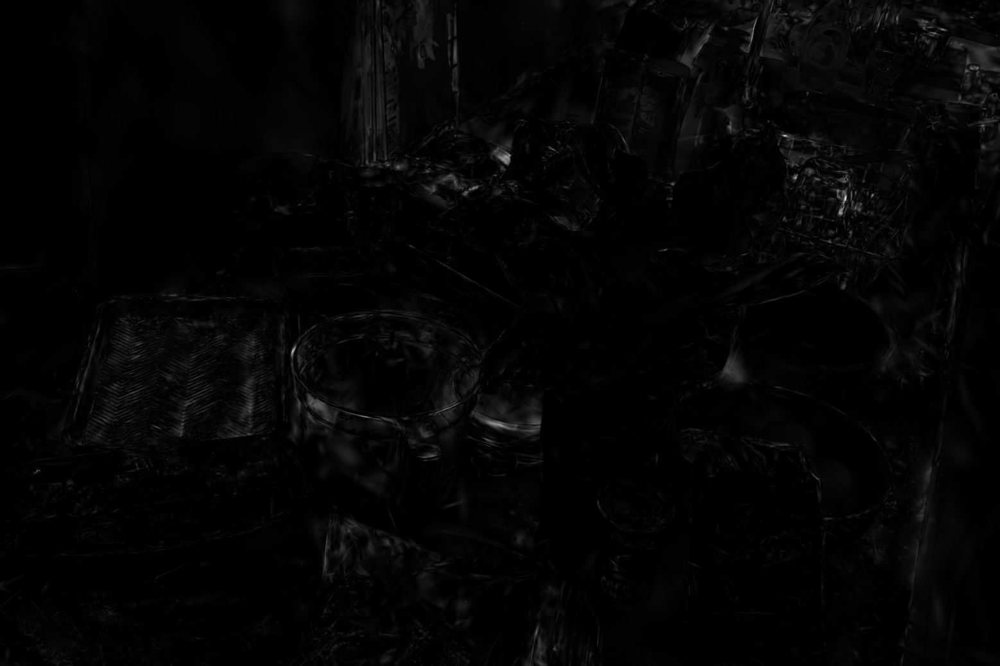</a> |  |

## median test view (test image `DSCF5993`, 1558x1038)

| | render | error map | zoom |
|---|---|---|---|
| **unpruned (reference)** `median_view_DSCF5993__unpruned.png` |  |  | <a href="median_view_DSCF5993__unpruned__zoom4x.png">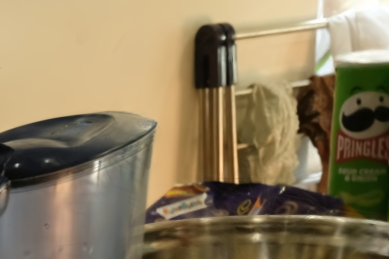</a> |
| **GA best: 52.4% of Gaussians kept, 41.9 dB PSNR vs unpruned** `median_view_DSCF5993__ga_best__52.4pct_kept__41.9dB.png` |  | <a href="median_view_DSCF5993__ga_best__52.4pct_kept__41.9dB__error.png">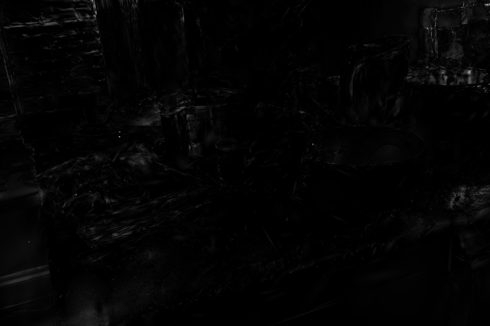</a> | <a href="median_view_DSCF5993__ga_best__52.4pct_kept__41.9dB__zoom4x.png">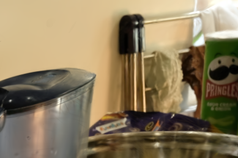</a> |
| **importance sweep: 55.6% of Gaussians kept, 46.7 dB PSNR vs unpruned** `median_view_DSCF5993__importance_sweep__55.6pct_kept__46.7dB.png` | <a href="median_view_DSCF5993__importance_sweep__55.6pct_kept__46.7dB.png">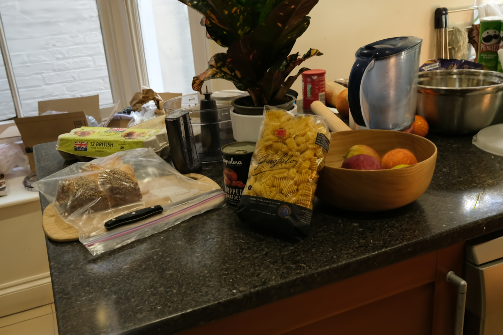</a> | <a href="median_view_DSCF5993__importance_sweep__55.6pct_kept__46.7dB__error.png">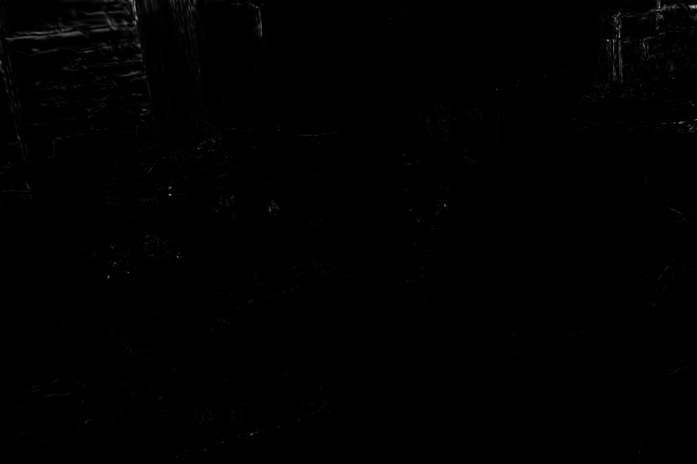</a> | <a href="median_view_DSCF5993__importance_sweep__55.6pct_kept__46.7dB__zoom4x.png">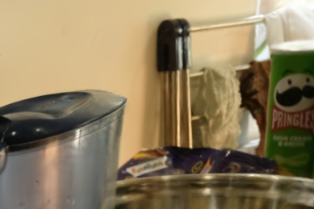</a> |
| **opacity sweep: 65.3% of Gaussians kept, 40.3 dB PSNR vs unpruned** `median_view_DSCF5993__opacity_sweep__65.3pct_kept__40.3dB.png` |  | <a href="median_view_DSCF5993__opacity_sweep__65.3pct_kept__40.3dB__error.png">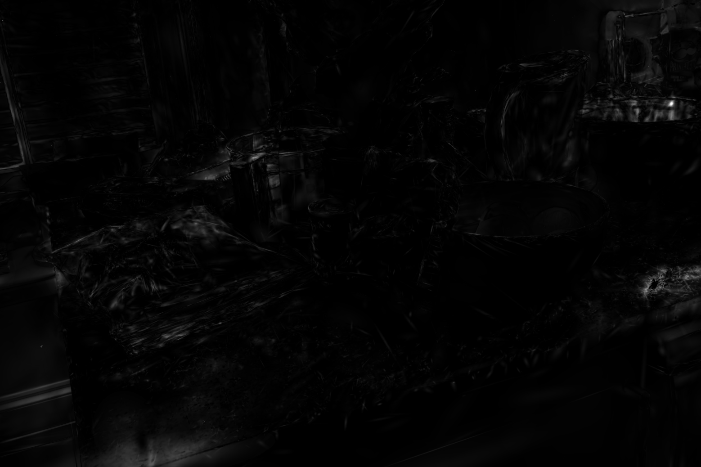</a> | <a href="median_view_DSCF5993__opacity_sweep__65.3pct_kept__40.3dB__zoom4x.png">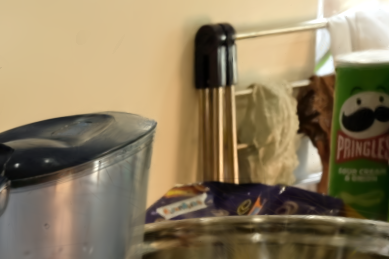</a> |
