# counter: individual renders (counter_4g_v32_w35_imax_res1_sres1)

Lossless full-resolution PNGs (8-bit, not resized). Error map: black = identical, white = pixel error >= 0.25 of full brightness. `zoom4x` = the yellow box of `../renders.jpg` (the window, 1/4 of the image's width and height, where the GA genome's error is highest, the same for every column of a view) cut out at native pixels; the overview shows it {ZOOM}x larger. PSNR is against the unpruned render of the same view.

## worst test view (test image `DSCF5961`, 1558x1038)

| | render | error map | zoom |
|---|---|---|---|
| **unpruned (reference)** `worst_view_DSCF5961__unpruned.jpg` | <a href="worst_view_DSCF5961__unpruned.jpg">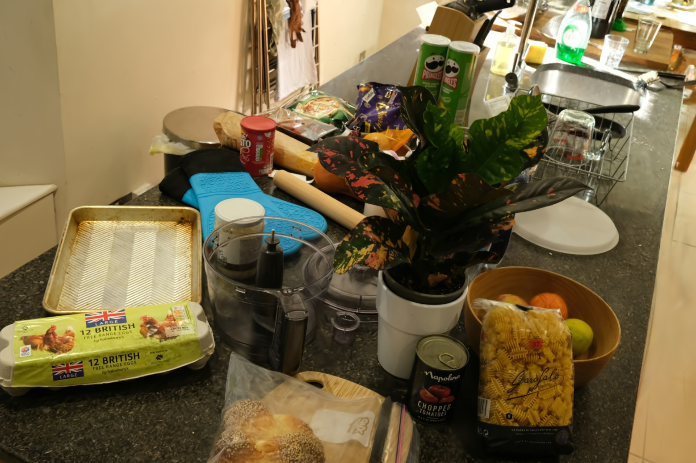</a> |  |  |
| **GA best: 44.2% of Gaussians kept, 37.1 dB PSNR vs unpruned** `worst_view_DSCF5961__ga_best__44.2pct_kept__37.1dB.jpg` |  |  |  |
| **importance sweep: 44.0% of Gaussians kept, 36.9 dB PSNR vs unpruned** `worst_view_DSCF5961__importance_sweep__44.0pct_kept__36.9dB.jpg` | <a href="worst_view_DSCF5961__importance_sweep__44.0pct_kept__36.9dB.jpg">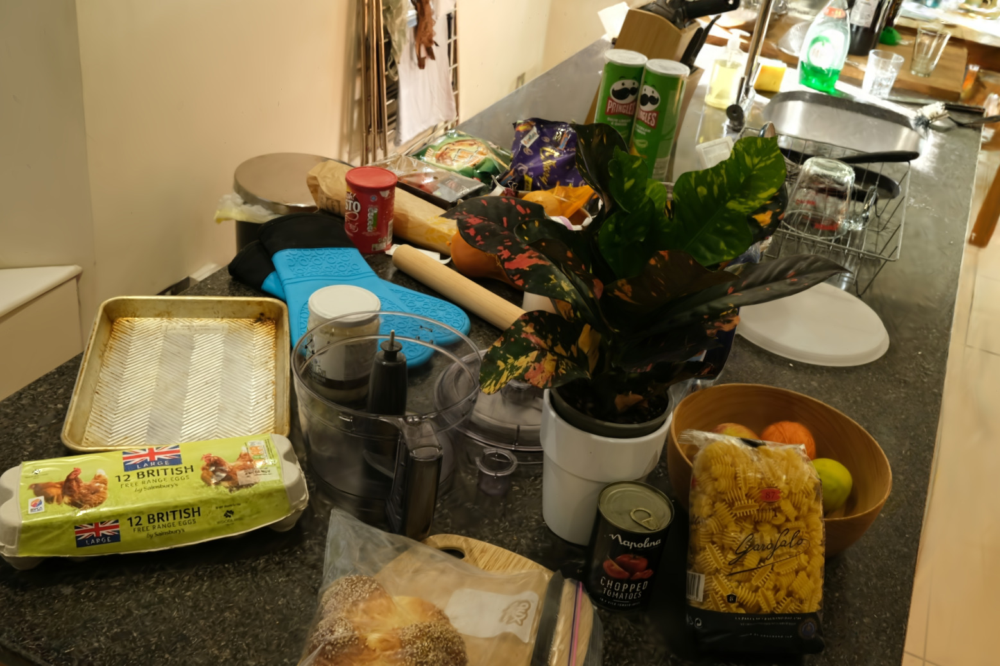</a> | <a href="worst_view_DSCF5961__importance_sweep__44.0pct_kept__36.9dB__error.jpg">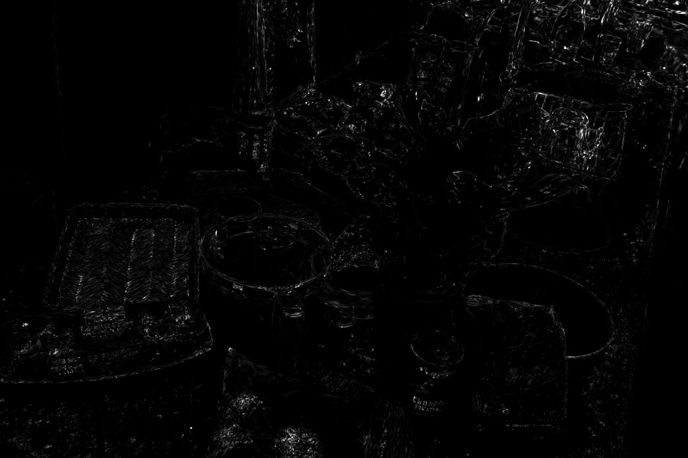</a> |  |
| **opacity sweep: 63.8% of Gaussians kept, 39.3 dB PSNR vs unpruned** `worst_view_DSCF5961__opacity_sweep__63.8pct_kept__39.3dB.jpg` | <a href="worst_view_DSCF5961__opacity_sweep__63.8pct_kept__39.3dB.jpg">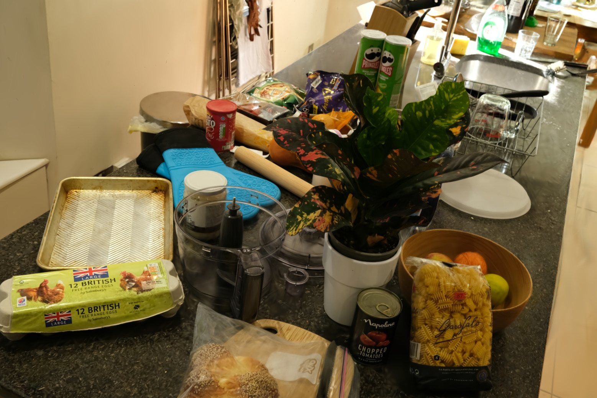</a> | <a href="worst_view_DSCF5961__opacity_sweep__63.8pct_kept__39.3dB__error.jpg">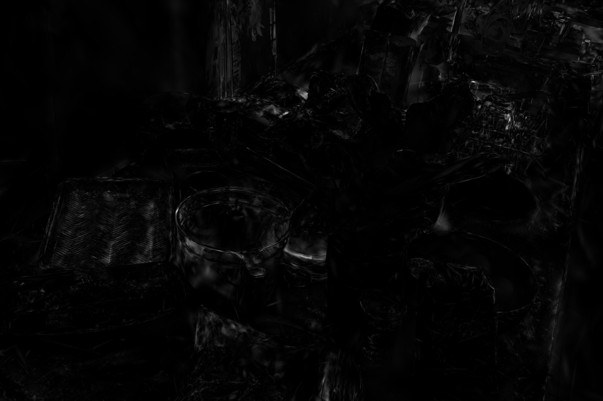</a> |  |

## median test view (test image `DSCF6001`, 1558x1038)

| | render | error map | zoom |
|---|---|---|---|
| **unpruned (reference)** `median_view_DSCF6001__unpruned.jpg` |  |  | <a href="median_view_DSCF6001__unpruned__zoom4x.jpg">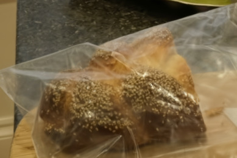</a> |
| **GA best: 44.2% of Gaussians kept, 40.1 dB PSNR vs unpruned** `median_view_DSCF6001__ga_best__44.2pct_kept__40.1dB.jpg` | <a href="median_view_DSCF6001__ga_best__44.2pct_kept__40.1dB.jpg">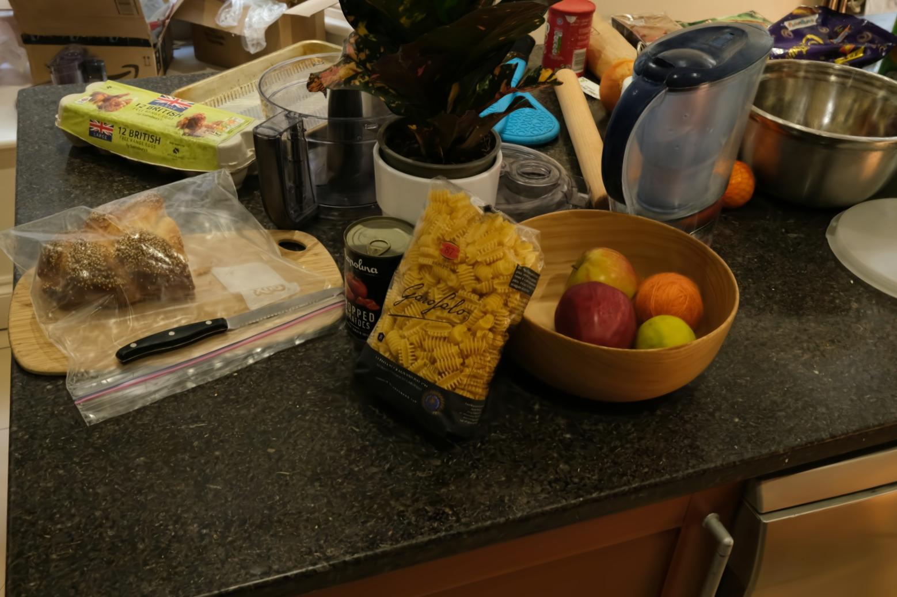</a> |  | <a href="median_view_DSCF6001__ga_best__44.2pct_kept__40.1dB__zoom4x.jpg">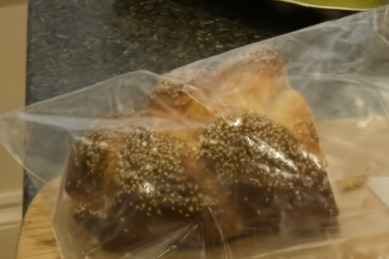</a> |
| **importance sweep: 44.0% of Gaussians kept, 40.0 dB PSNR vs unpruned** `median_view_DSCF6001__importance_sweep__44.0pct_kept__40.0dB.jpg` |  | <a href="median_view_DSCF6001__importance_sweep__44.0pct_kept__40.0dB__error.jpg">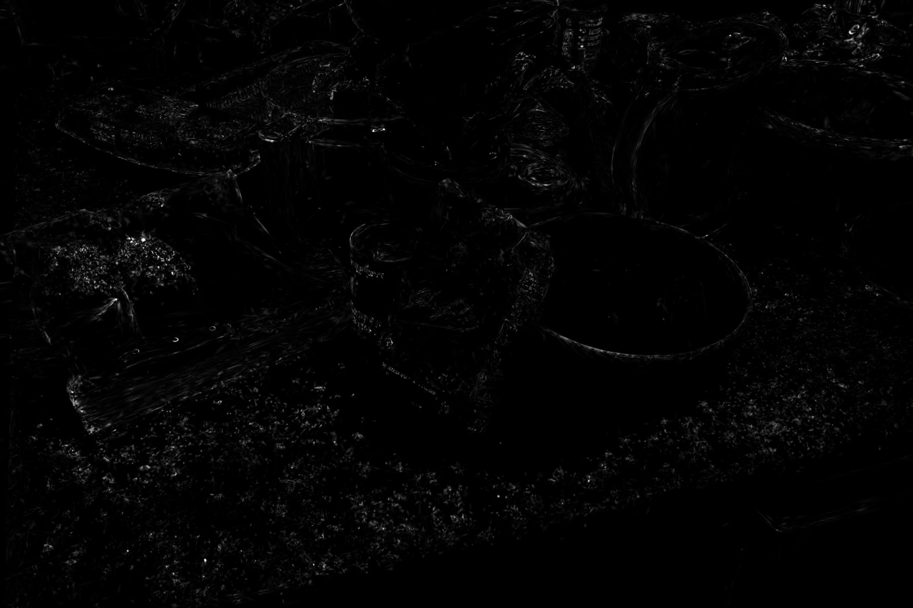</a> |  |
| **opacity sweep: 63.8% of Gaussians kept, 40.2 dB PSNR vs unpruned** `median_view_DSCF6001__opacity_sweep__63.8pct_kept__40.2dB.jpg` |  | <a href="median_view_DSCF6001__opacity_sweep__63.8pct_kept__40.2dB__error.jpg">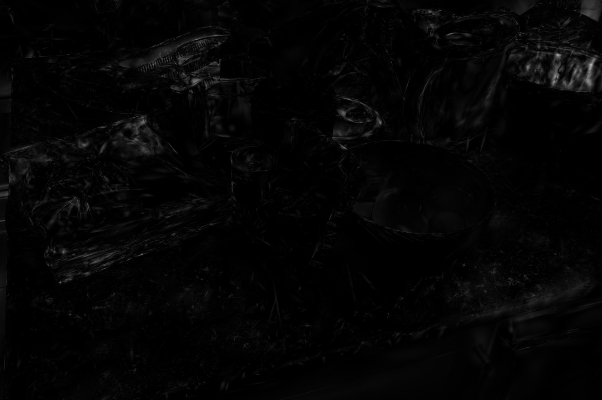</a> | <a href="median_view_DSCF6001__opacity_sweep__63.8pct_kept__40.2dB__zoom4x.jpg">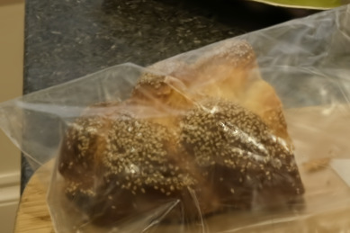</a> |
