# garden: individual renders (garden_4g_v32_w35)

Lossless full-resolution PNGs (8-bit, not resized). Error map: black = identical, white = pixel error >= 0.25 of full brightness. `zoom4x` = the yellow box of `../renders.jpg` (the window, 1/4 of the image's width and height, where the GA genome's error is highest, the same for every column of a view) cut out at native pixels; the overview shows it {ZOOM}x larger. PSNR is against the unpruned render of the same view.

## worst test view (test image `DSC07988`, 1297x840)

| | render | error map | zoom |
|---|---|---|---|
| **unpruned (reference)** `worst_view_DSC07988__unpruned.png` |  |  |  |
| **GA best: 57.4% of Gaussians kept, 24.3 dB PSNR vs unpruned** `worst_view_DSC07988__ga_best__57.4pct_kept__24.3dB.png` |  | <a href="worst_view_DSC07988__ga_best__57.4pct_kept__24.3dB__error.png">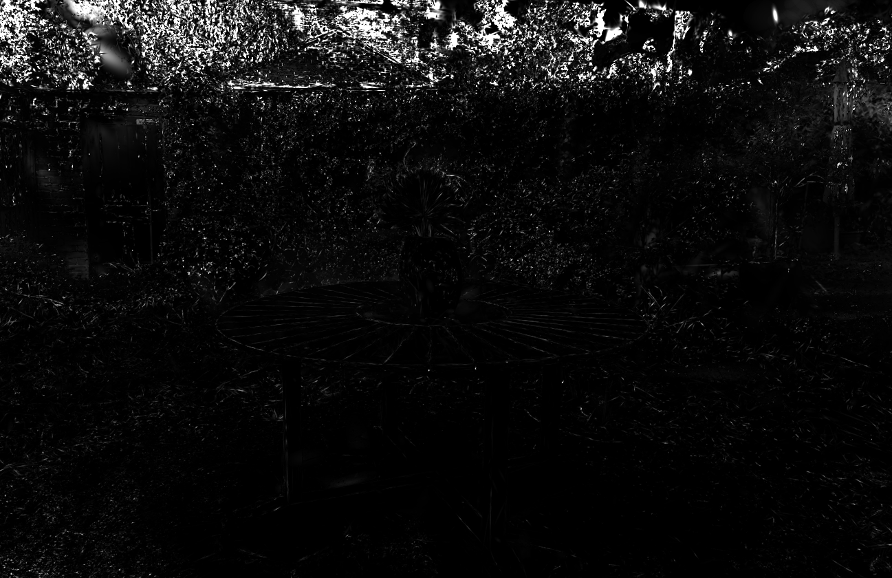</a> | <a href="worst_view_DSC07988__ga_best__57.4pct_kept__24.3dB__zoom4x.png">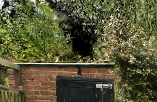</a> |
| **importance sweep: 63.5% of Gaussians kept, 24.1 dB PSNR vs unpruned** `worst_view_DSC07988__importance_sweep__63.5pct_kept__24.1dB.png` | <a href="worst_view_DSC07988__importance_sweep__63.5pct_kept__24.1dB.png">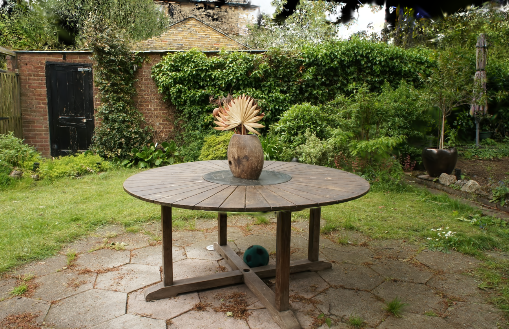</a> | <a href="worst_view_DSC07988__importance_sweep__63.5pct_kept__24.1dB__error.png">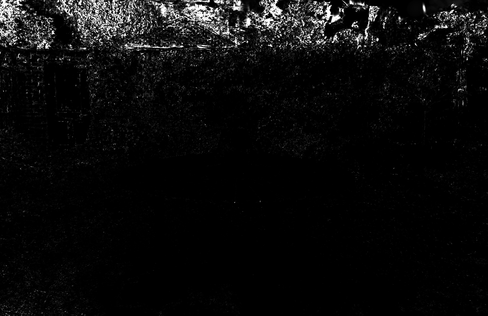</a> | <a href="worst_view_DSC07988__importance_sweep__63.5pct_kept__24.1dB__zoom4x.png">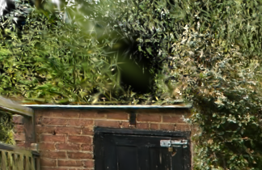</a> |
| **opacity sweep: 67.2% of Gaussians kept, 41.2 dB PSNR vs unpruned** `worst_view_DSC07988__opacity_sweep__67.2pct_kept__41.2dB.png` | <a href="worst_view_DSC07988__opacity_sweep__67.2pct_kept__41.2dB.png">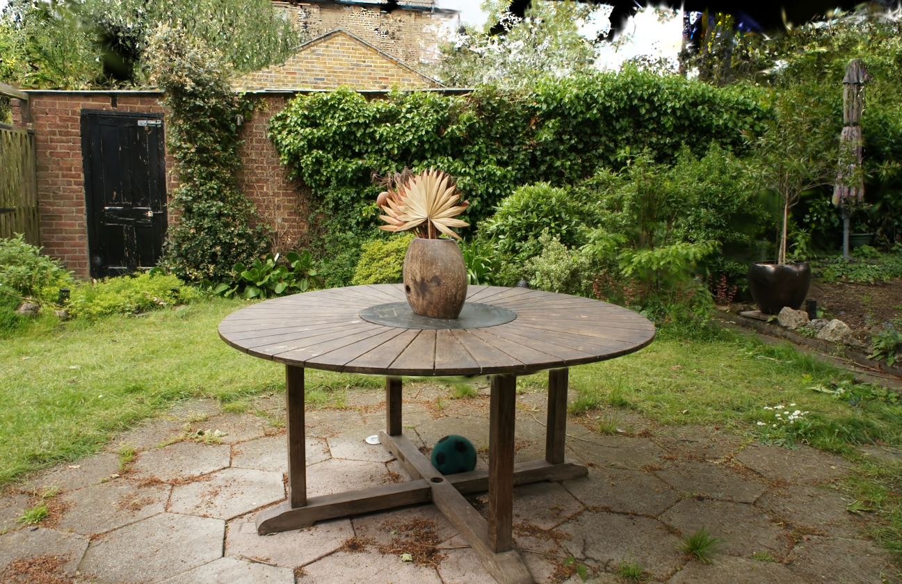</a> | <a href="worst_view_DSC07988__opacity_sweep__67.2pct_kept__41.2dB__error.png">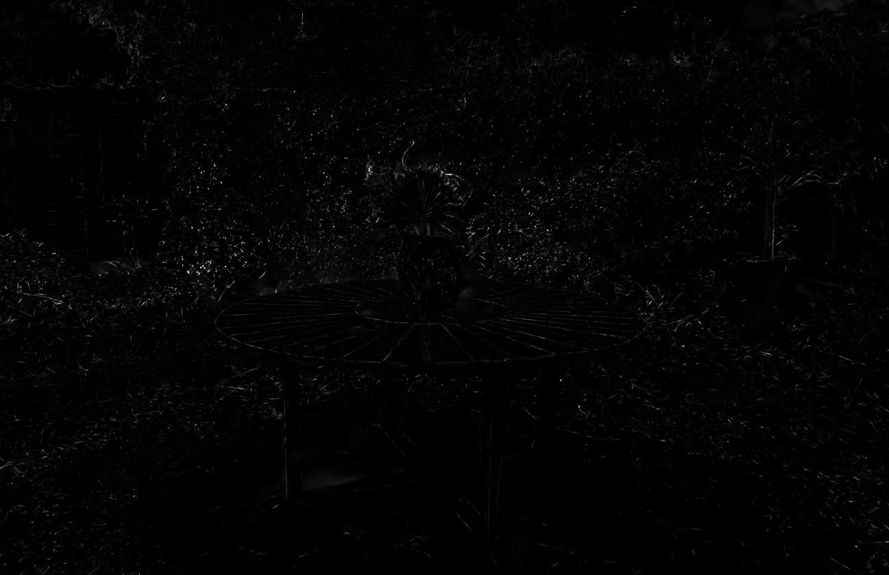</a> | <a href="worst_view_DSC07988__opacity_sweep__67.2pct_kept__41.2dB__zoom4x.png">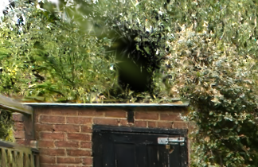</a> |

## median test view (test image `DSC08004`, 1297x840)

| | render | error map | zoom |
|---|---|---|---|
| **unpruned (reference)** `median_view_DSC08004__unpruned.png` |  |  |  |
| **GA best: 57.4% of Gaussians kept, 38.8 dB PSNR vs unpruned** `median_view_DSC08004__ga_best__57.4pct_kept__38.8dB.png` | <a href="median_view_DSC08004__ga_best__57.4pct_kept__38.8dB.png">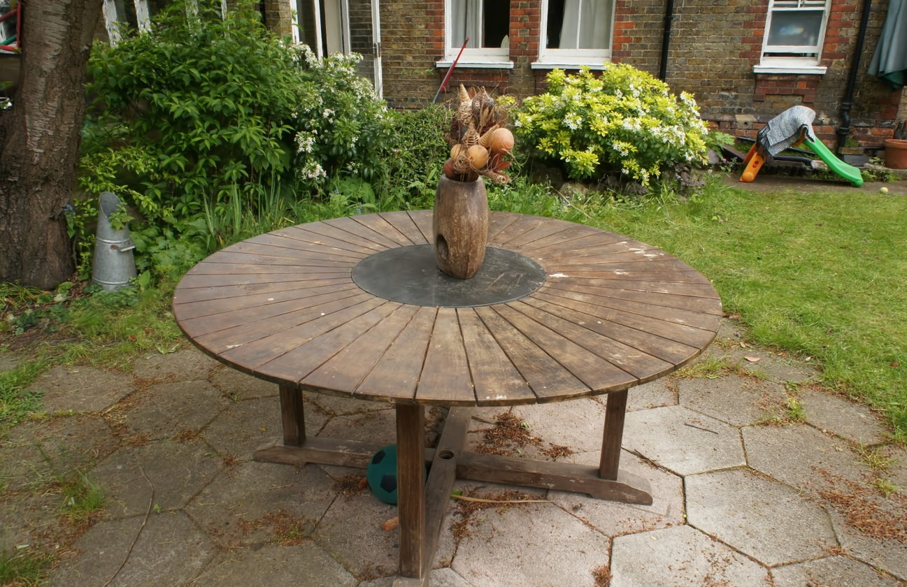</a> | <a href="median_view_DSC08004__ga_best__57.4pct_kept__38.8dB__error.png">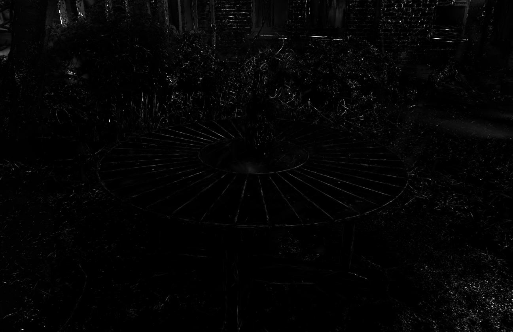</a> |  |
| **importance sweep: 63.5% of Gaussians kept, 41.0 dB PSNR vs unpruned** `median_view_DSC08004__importance_sweep__63.5pct_kept__41.0dB.png` |  | <a href="median_view_DSC08004__importance_sweep__63.5pct_kept__41.0dB__error.png">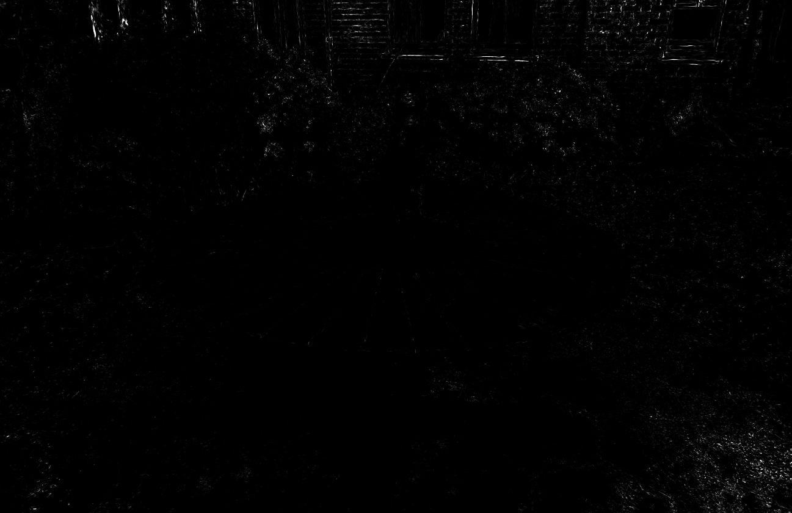</a> |  |
| **opacity sweep: 67.2% of Gaussians kept, 42.1 dB PSNR vs unpruned** `median_view_DSC08004__opacity_sweep__67.2pct_kept__42.1dB.png` |  | <a href="median_view_DSC08004__opacity_sweep__67.2pct_kept__42.1dB__error.png">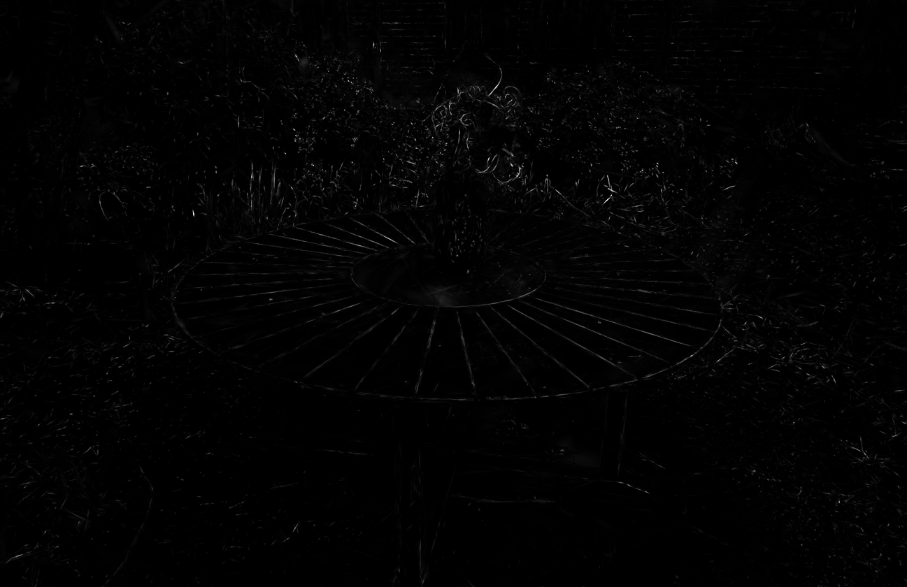</a> |  |
